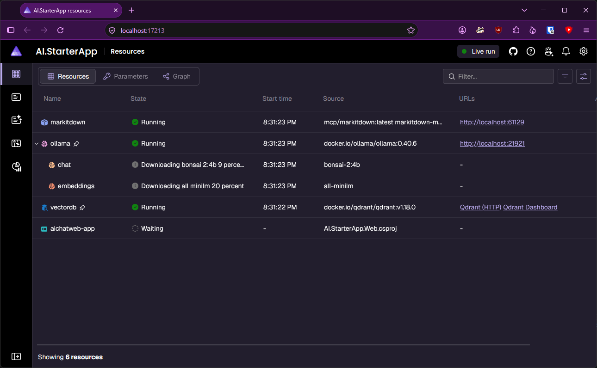
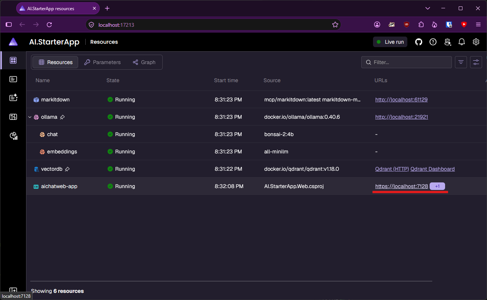
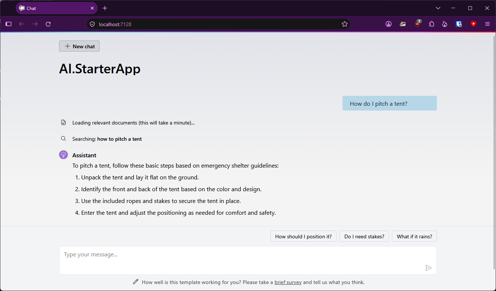

# Modern .NET 2026 Workshop

This repo contains the required preparation steps for the workshop:

- Install .NET 11 SDK (RC2)
  - https://dotnet.microsoft.com/en-us/download/dotnet/11.0
- Make sure to have a container-runtime supported by .NET Aspire:
  - Podman
  - Docker
- Your favorite IDE *with .NET 11 support*, which includes
  - VS Code with C# Dev Kit (latest)
  - Visual Studio Insiders (latest)
- Verify by running `HelloNet11.cs`
  - If your IDE doesn't support file-based apps out of the box, use `dotnet run HelloNet11.cs`
- Open `AI.StarterApp/AI.StarterApp.slnx`
  - :information_source: Based on the chat template from Microsoft.Extensions.AI.Templates
  - Run `AI.StarterApp.AppHost`
  - Aspire will start all dependencies and Ollama will start downloading a small embedding and a small LLM:
    
  - When all is green, go to the chat web:
    
  - Ask how to setup a tent (be patient, the first prompt takes a bit of a time):
    
  - If you get a response, you're all set!

> Note on the container & volume lifetime: Both Ollama and the vector are persistent, meaning they can be reused across debug session. You can stop the containers now, but do not delete the volumes or you'll need to redownload the models respectively loose any saved embeddings.